# Pinterest pins 2026-10-19 (not scheduled)

Pinterest-native pins (1000x1500, 2:3) for the SEO money landings, built from the real example books. Not scheduled. Render: node scripts/social/render-pins.mjs docs/social/pinterest/2026-10-19/pins.json

## es_reyes_gift

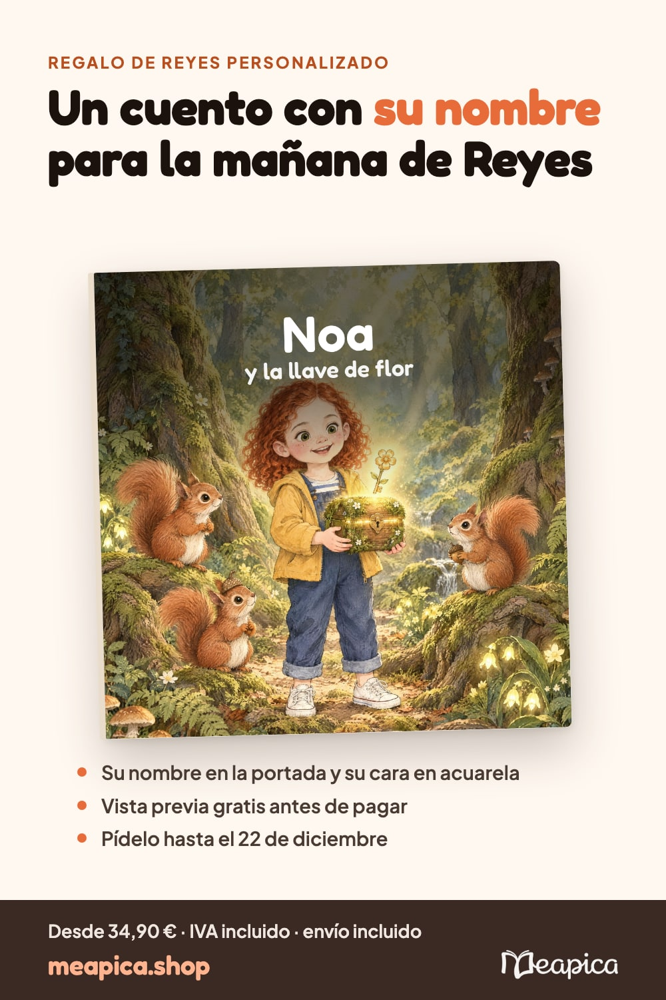

- **Board:** Regalos de Reyes para niños
- **Title:** Regalo de Reyes personalizado: un cuento con su nombre y su cara
- **Link:** https://meapica.shop/es/gifts/three-kings?utm_source=pinterest&utm_medium=organic_social&utm_campaign=org_q4-26-pins&utm_content=org_pi_pin_es_reyes_gift
- **Alt:** Portada del cuento de ejemplo «Noa y la llave de flor»: una niña pelirroja con un cofre entre ardillas en un bosque, con el texto Un cuento con su nombre para la mañana de Reyes.

Regalo de Reyes original para niños de 2 a 12 años: un cuento personalizado con su nombre en la portada y su retrato en acuarela, en la aventura que elijas (bosque, dinosaurios, piratas, espacio). Ves la portada, su retrato y 3 escenas gratis antes de pagar. Tapa blanda 34,90 € o tapa dura 49,90 €, IVA incluido, envío incluido a península y Baleares. Para tenerlo en casa antes del 5 de enero, pídelo hasta el 22 de diciembre.

## es_reyes_letter

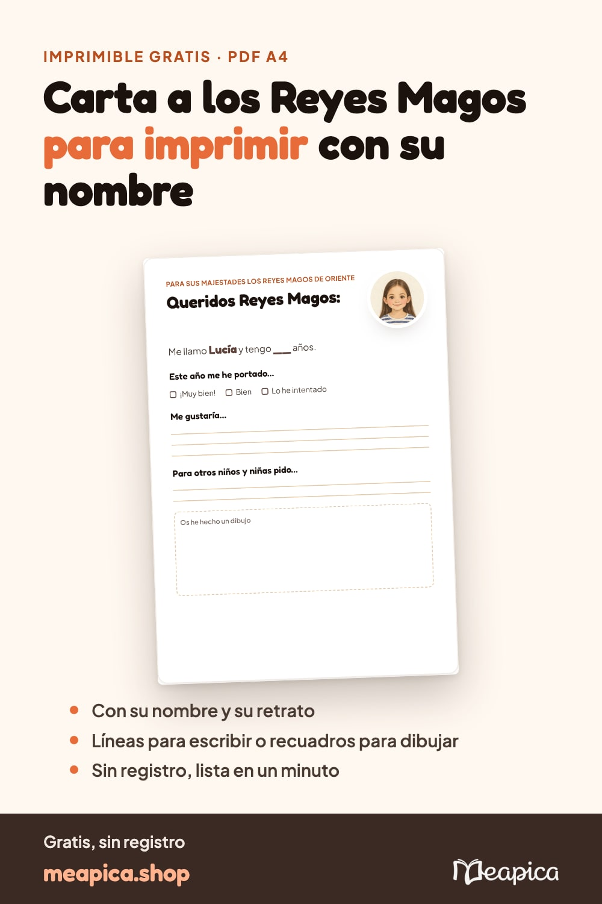

- **Board:** Regalos de Reyes para niños
- **Title:** Carta a los Reyes Magos para imprimir gratis, con su nombre y su retrato
- **Link:** https://meapica.shop/es/tools/letter-to-the-three-kings?utm_source=pinterest&utm_medium=organic_social&utm_campaign=org_q4-26-pins&utm_content=org_pi_pin_es_reyes_letter
- **Alt:** Carta a los Reyes Magos para imprimir: «Queridos Reyes Magos», casillas de cómo se ha portado, líneas para pedir y un recuadro para dibujar, con el retrato de la niña.

Carta a los Reyes Magos para imprimir gratis en A4: escribe su nombre, elige su retrato en acuarela y descarga el PDF. Versión con líneas para los que ya escriben y con recuadros para dibujar para los más peques. Sin registro. Imprímela, rellenadla juntos y dejadla en el buzón real.

## es_reyes_deadline

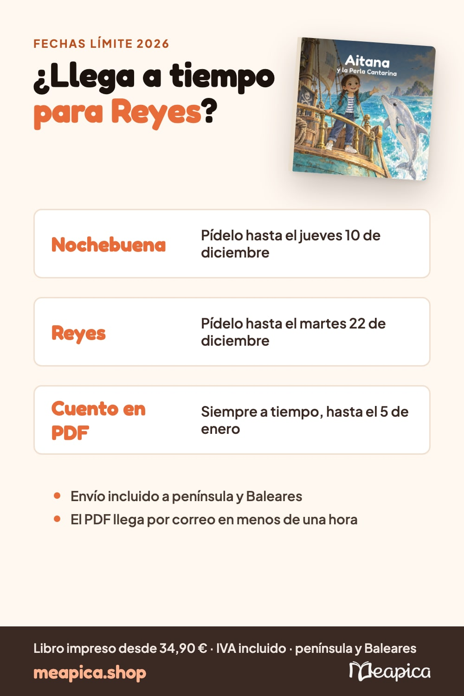

- **Board:** Regalos de Reyes para niños
- **Title:** Cuento personalizado para Reyes: hasta cuándo pedirlo para que llegue a tiempo
- **Link:** https://meapica.shop/es/christmas-delivery?utm_source=pinterest&utm_medium=organic_social&utm_campaign=org_q4-26-pins&utm_content=org_pi_pin_es_reyes_deadline
- **Alt:** Calendario de fechas límite para Reyes: Nochebuena hasta el 10 de diciembre, Reyes hasta el 22 de diciembre, PDF siempre a tiempo, junto a la portada del cuento de Aitana.

¿Llega a tiempo para Reyes? Fechas límite para pedir un cuento personalizado impreso: hasta el 10 de diciembre para Nochebuena y hasta el 22 de diciembre para Reyes, con envío a península y Baleares. El cuento en PDF llega por correo en menos de una hora, así que puedes pedirlo incluso el 5 de enero. Tapa blanda 34,90 €, tapa dura 49,90 €, PDF 9,90 €, IVA incluido.

## es_christmas

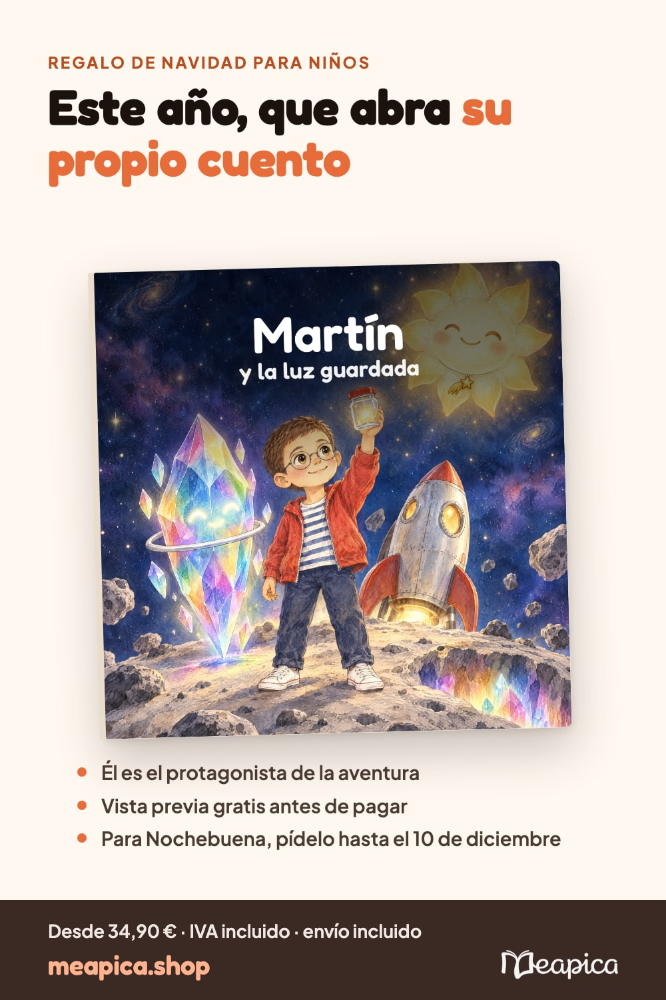

- **Board:** Regalos de Navidad para niños
- **Title:** Regalo de Navidad para niños: un cuento personalizado con su nombre
- **Link:** https://meapica.shop/es/gifts/christmas?utm_source=pinterest&utm_medium=organic_social&utm_campaign=org_q4-26-pins&utm_content=org_pi_pin_es_christmas
- **Alt:** Portada del cuento de ejemplo «Martín y la luz guardada», una aventura en el espacio, con el texto Este año, que abra su propio cuento.

Idea de regalo de Navidad para niños que ya lo tienen todo: un cuento personalizado donde es el protagonista, con su nombre en la portada y su cara en acuarela. Elige la aventura: espacio, dinosaurios, piratas, bosque mágico. Mira la portada, su retrato y 3 escenas gratis antes de pagar. Desde 34,90 €, IVA incluido, envío incluido. Para Nochebuena, pídelo hasta el 10 de diciembre.

## es_birthday

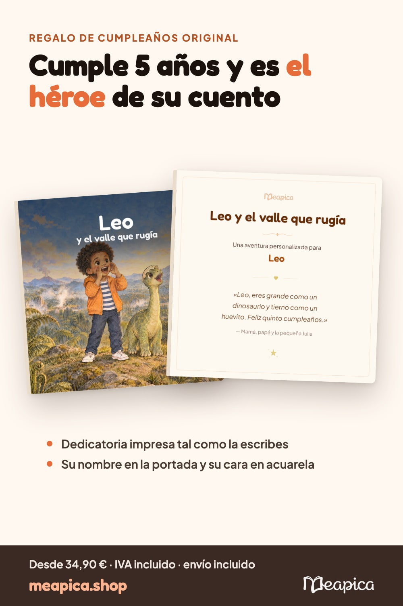

- **Board:** Regalos de cumpleaños para niños
- **Title:** Regalo de cumpleaños original para niños: un cuento con su nombre
- **Link:** https://meapica.shop/es/gifts/birthday?utm_source=pinterest&utm_medium=organic_social&utm_campaign=org_q4-26-pins&utm_content=org_pi_pin_es_birthday
- **Alt:** Portada y dedicatoria del cuento de ejemplo «Leo y el valle que rugía»: un niño con un dinosaurio y la dedicatoria «Feliz quinto cumpleaños».

Regalo de cumpleaños personalizado para niño o niña: un cuento donde es el protagonista, con su nombre en la portada, su cara en acuarela y tu dedicatoria impresa en la primera página. Mejor que otro juguete: un libro que leerá mil veces. Ejemplo real: «Leo y el valle que rugía», para su quinto cumpleaños. Desde 34,90 €, IVA incluido, envío incluido. Vista previa gratis.

## es_age_2_4

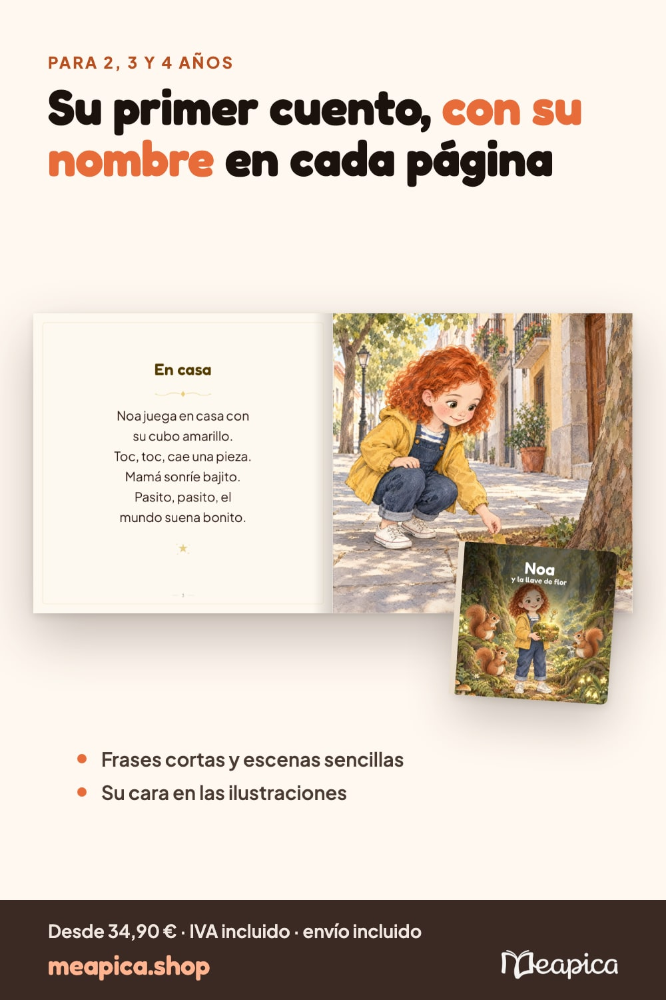

- **Board:** Cuentos personalizados por edad
- **Title:** Cuento personalizado para niños de 2, 3 y 4 años con su nombre
- **Link:** https://meapica.shop/es/personalized-books/2-4?utm_source=pinterest&utm_medium=organic_social&utm_campaign=org_q4-26-pins&utm_content=org_pi_pin_es_age_2_4
- **Alt:** Doble página del cuento de ejemplo de Noa, 4 años: texto corto «En casa» y la ilustración de Noa recogiendo una hoja en la calle.

Cuento personalizado para niños de 2 a 4 años: frases cortas, escenas sencillas y su propio nombre y cara en cada página, para engancharle a los libros desde pequeño. Así es por dentro el ejemplo real «Noa y la llave de flor». Vista previa gratis antes de pagar. Tapa blanda 34,90 €, tapa dura 49,90 €, IVA incluido, envío incluido.

## es_age_5_7

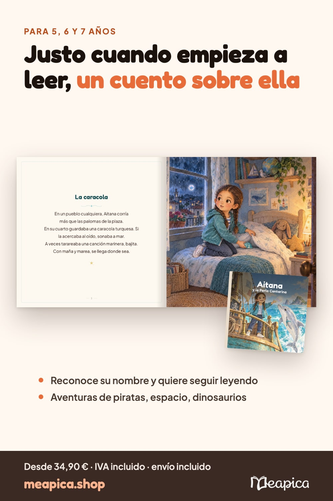

- **Board:** Cuentos personalizados por edad
- **Title:** Cuento personalizado para niños de 5, 6 y 7 años: su propia aventura
- **Link:** https://meapica.shop/es/personalized-books/5-7?utm_source=pinterest&utm_medium=organic_social&utm_campaign=org_q4-26-pins&utm_content=org_pi_pin_es_age_5_7
- **Alt:** Doble página del cuento de ejemplo de Aitana, 6 años, una aventura de piratas: página de texto y la ilustración de Aitana.

Cuento personalizado para niños de 5 a 7 años, la edad en que empiezan a leer solos: verse como héroe de su propio cuento les motiva a seguir. Su nombre en la portada, su cara en acuarela y la aventura que eliges. Así es por dentro el ejemplo real «Aitana y la perla cantarina». Desde 34,90 €, IVA incluido, envío incluido. Vista previa gratis.

## es_age_8_12

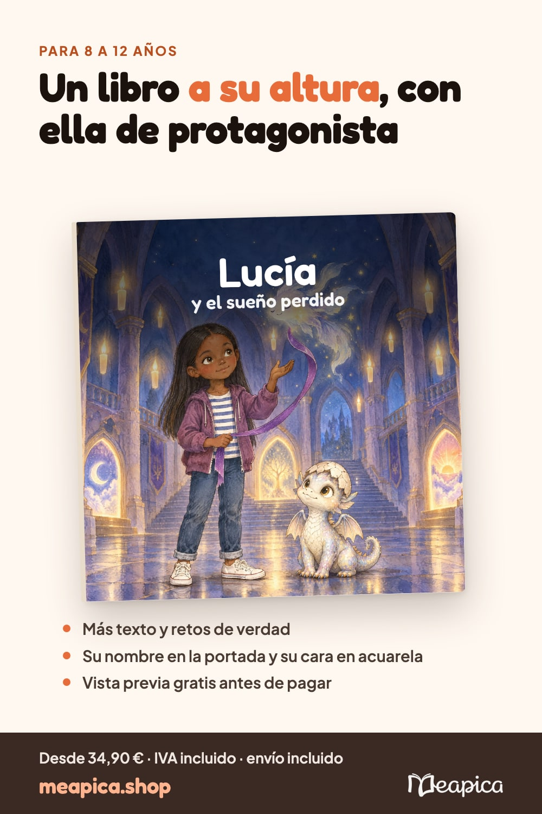

- **Board:** Cuentos personalizados por edad
- **Title:** Libro personalizado para niños de 8 a 12 años con su nombre
- **Link:** https://meapica.shop/es/personalized-books/8-12?utm_source=pinterest&utm_medium=organic_social&utm_campaign=org_q4-26-pins&utm_content=org_pi_pin_es_age_8_12
- **Alt:** Portada del cuento de ejemplo «Lucía y el sueño perdido», una aventura en un castillo, con el texto Un libro a su altura.

Libro personalizado para lectores de 8 a 12 años: aventuras con más texto y retos de verdad, donde la protagonista es ella, con su nombre en la portada y su retrato en acuarela. Ejemplo real: «Lucía y el sueño perdido». Mira la portada, su retrato y 3 escenas gratis antes de pagar. Desde 34,90 €, IVA incluido, envío incluido.

## es_examples

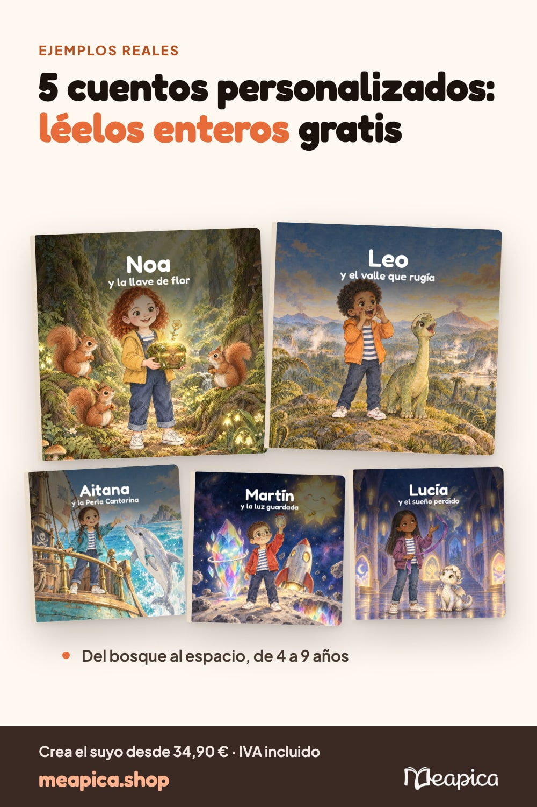

- **Board:** Cuentos personalizados para niños
- **Title:** Ejemplos de cuentos personalizados para niños: léelos enteros
- **Link:** https://meapica.shop/es/examples?utm_source=pinterest&utm_medium=organic_social&utm_campaign=org_q4-26-pins&utm_content=org_pi_pin_es_examples
- **Alt:** Cinco portadas de cuentos personalizados de ejemplo: Noa, Leo, Aitana, Martín y Lucía.

Ideas de cuentos personalizados para niños: 5 ejemplos reales para leer enteros antes de crear el tuyo. Noa en el bosque (4 años), Leo y los dinosaurios (5), Aitana y los piratas (6), Martín en el espacio (7) y Lucía en el castillo (9). Cada uno con su nombre en la portada y su cara en acuarela. Desde 34,90 €, IVA incluido.

## es_looks_like

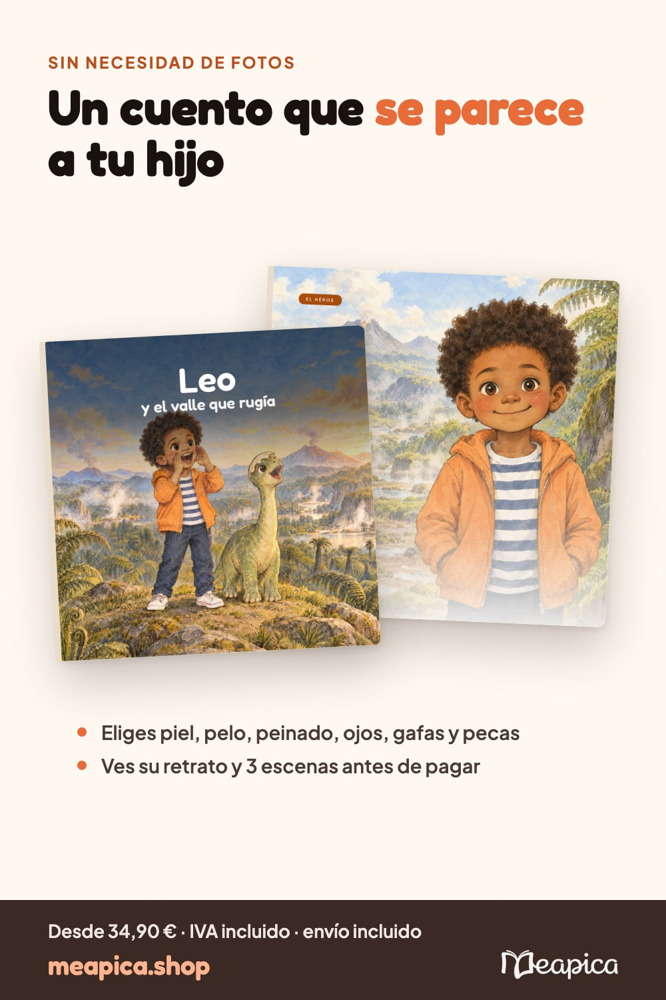

- **Board:** Cuentos personalizados para niños
- **Title:** Cuento personalizado que se parece a tu hijo, sin necesidad de fotos
- **Link:** https://meapica.shop/es/personalized-books/looks-like-your-child?utm_source=pinterest&utm_medium=organic_social&utm_campaign=org_q4-26-pins&utm_content=org_pi_pin_es_looks_like
- **Alt:** Portada y retrato en acuarela del protagonista del cuento de ejemplo de Leo, un niño de pelo rizado con chaqueta naranja.

Cuento personalizado con un protagonista que se parece a tu hijo, sin necesidad de fotos: eliges piel, pelo, peinado, ojos, gafas y pecas, y su retrato en acuarela aparece en cada escena. Ves la portada, su retrato y 3 escenas gratis antes de pagar. Desde 34,90 €, IVA incluido, envío incluido.

## ca_tio

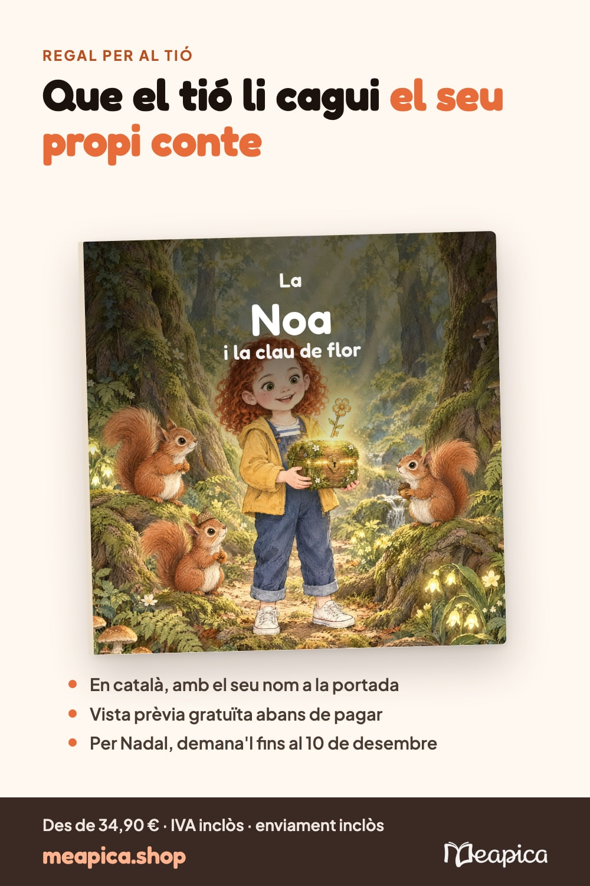

- **Board:** Contes personalitzats en català
- **Title:** Regal per al tió de Nadal: un conte en català amb el seu nom
- **Link:** https://meapica.shop/ca/gifts/tio-de-nadal?utm_source=pinterest&utm_medium=organic_social&utm_campaign=org_q4-26-pins&utm_content=org_pi_pin_ca_tio
- **Alt:** Portada del conte d'exemple «La Noa i la clau de flor», una nena pèl-roja amb un cofre entre esquirols, amb el text Que el tió li cagui el seu propi conte.

Idea de regal per fer cagar el tió: un conte personalitzat en català amb el seu nom a la portada i el seu retrat a l'aquarel·la, a l'aventura que triïs. Mira la portada, el retrat i 3 escenes gratis abans de pagar. Tapa tova 34,90 €, tapa dura 49,90 €, IVA inclòs, enviament inclòs. Per tenir-lo a casa el 24 de desembre, demana'l fins al 10 de desembre.

## ca_reis

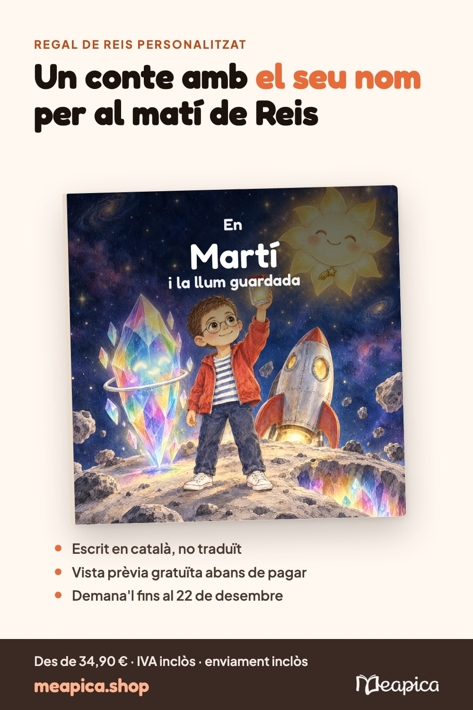

- **Board:** Contes personalitzats en català
- **Title:** Regal de Reis personalitzat: un conte en català amb el seu nom
- **Link:** https://meapica.shop/ca/gifts/three-kings?utm_source=pinterest&utm_medium=organic_social&utm_campaign=org_q4-26-pins&utm_content=org_pi_pin_ca_reis
- **Alt:** Portada del conte d'exemple «En Martí i la llum guardada», una aventura a l'espai, amb el text Un conte amb el seu nom per al matí de Reis.

Regal de Reis original per a nens de 2 a 12 anys: un conte personalitzat en català amb el seu nom a la portada i la seva cara a l'aquarel·la. Tries l'aventura: espai, dinosaures, pirates, bosc màgic. Vista prèvia gratuïta. Tapa tova 34,90 € o tapa dura 49,90 €, IVA inclòs, enviament inclòs a la península i les Balears. Per tenir-lo abans del 5 de gener, demana'l fins al 22 de desembre.

## ca_reis_letter

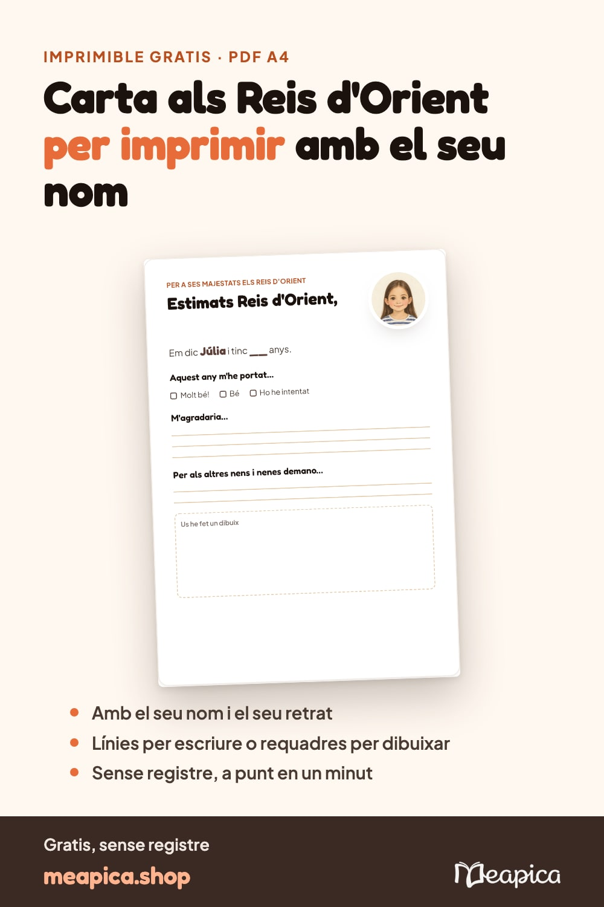

- **Board:** Contes personalitzats en català
- **Title:** Carta als Reis d'Orient per imprimir gratis, amb el seu nom
- **Link:** https://meapica.shop/ca/tools/letter-to-the-three-kings?utm_source=pinterest&utm_medium=organic_social&utm_campaign=org_q4-26-pins&utm_content=org_pi_pin_ca_reis_letter
- **Alt:** Carta als Reis d'Orient per imprimir en català amb caselles, línies per demanar, un requadre per dibuixar i el retrat de la nena.

Carta als Reis d'Orient per imprimir gratis en A4 i en català: escriu el seu nom, tria el seu retrat a l'aquarel·la i descarrega el PDF. Versió amb línies per als que ja escriuen i amb requadres per dibuixar per als més petits. Sense registre. Imprimiu-la, ompliu-la junts i deixeu-la a la bústia reial.

## ca_in_catalan

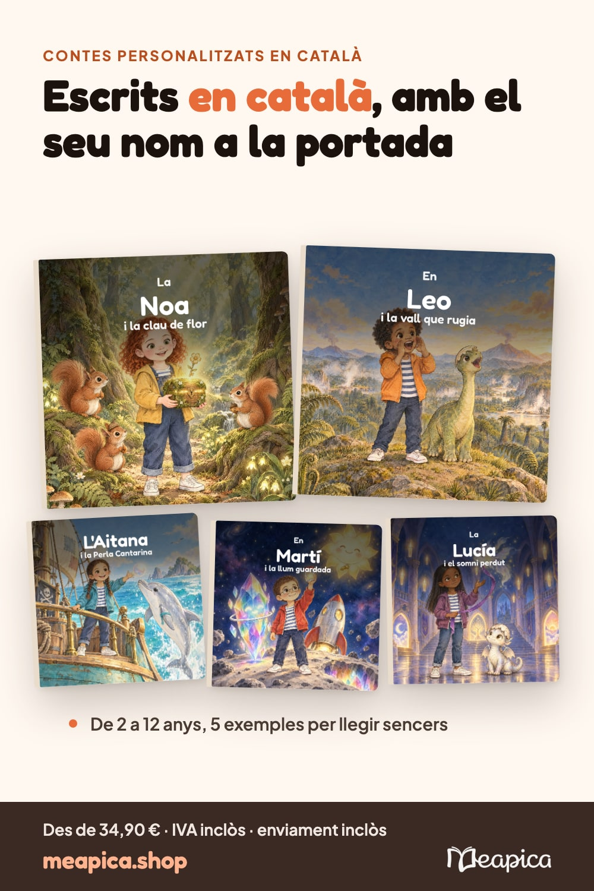

- **Board:** Contes personalitzats en català
- **Title:** Contes personalitzats en català per a nens, amb el seu nom
- **Link:** https://meapica.shop/ca/personalized-books/in-catalan?utm_source=pinterest&utm_medium=organic_social&utm_campaign=org_q4-26-pins&utm_content=org_pi_pin_ca_in_catalan
- **Alt:** Cinc portades de contes personalitzats en català: la Noa, en Leo, l'Aitana, en Martí i la Lucía.

Contes personalitzats en català escrits directament en català, no traduïts: el seu nom a la portada i el seu retrat a l'aquarel·la. Llegeix sencers 5 exemples reals: la Noa al bosc, en Leo i els dinosaures, l'Aitana i els pirates, en Martí a l'espai i la Lucía al castell. Vista prèvia gratuïta. Des de 34,90 €, IVA inclòs, enviament inclòs.

## ca_sant_jordi

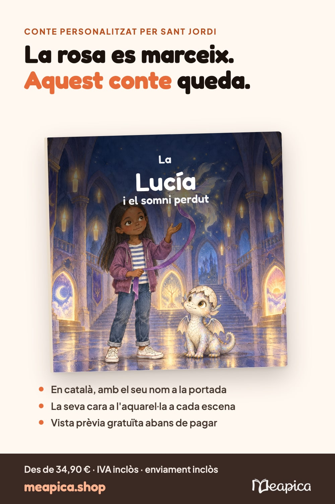

- **Board:** Contes personalitzats en català
- **Title:** Conte personalitzat per Sant Jordi: el llibre on és el protagonista
- **Link:** https://meapica.shop/ca/gifts/sant-jordi?utm_source=pinterest&utm_medium=organic_social&utm_campaign=org_q4-26-pins&utm_content=org_pi_pin_ca_sant_jordi
- **Alt:** Portada del conte d'exemple «La Lucía i el somni perdut», una aventura en un castell, amb el text La rosa es marceix, aquest conte queda.

Per Sant Jordi, regala el llibre més personal: un conte en català on el teu fill o filla és el protagonista, amb el seu nom a la portada i el seu retrat a l'aquarel·la. Exemple real: «La Lucía i el somni perdut». Vista prèvia gratuïta abans de pagar. Tapa tova 34,90 €, tapa dura 49,90 €, IVA inclòs, enviament inclòs.
